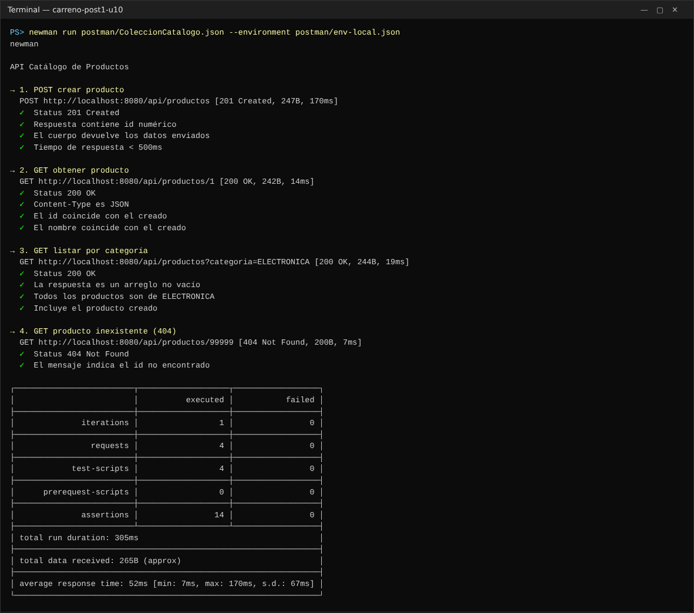
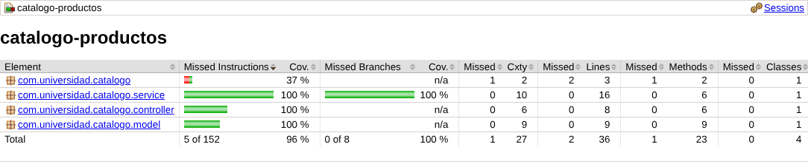
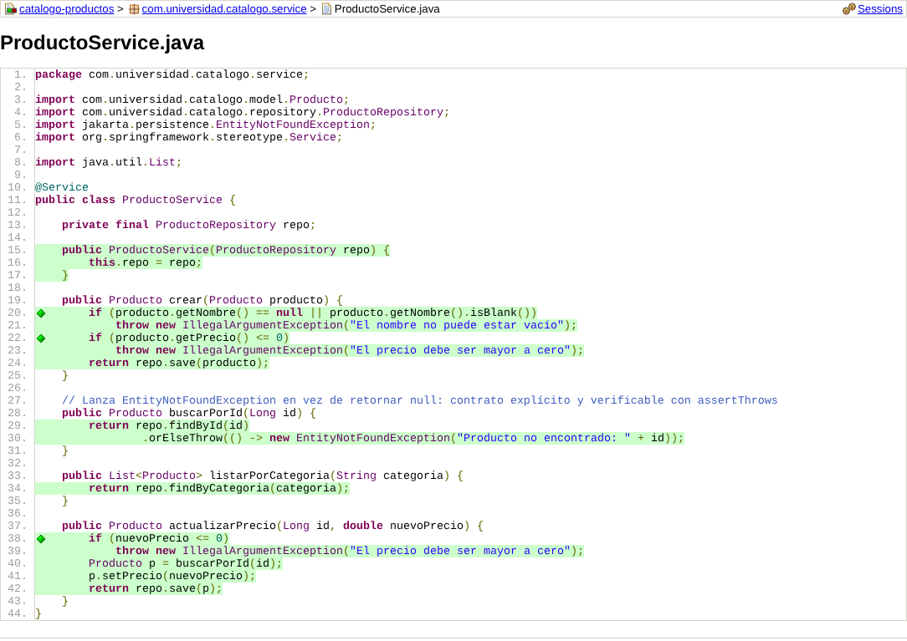
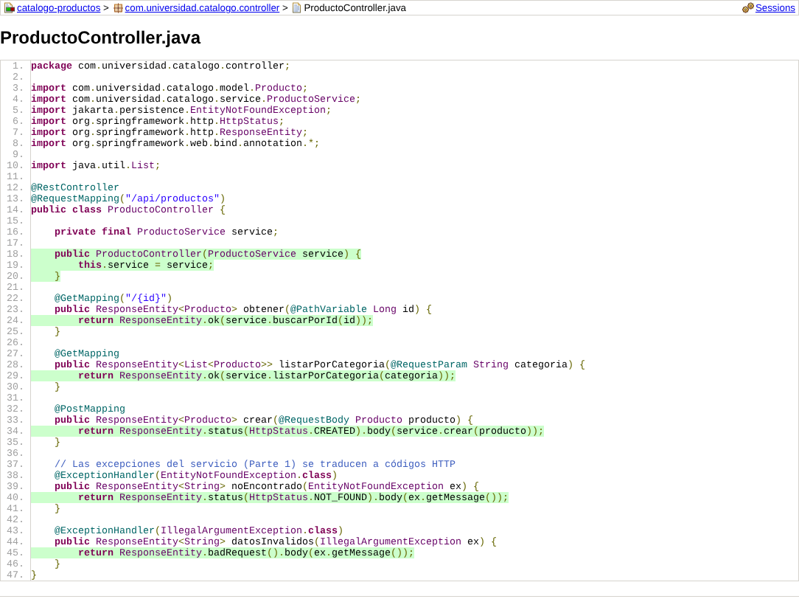
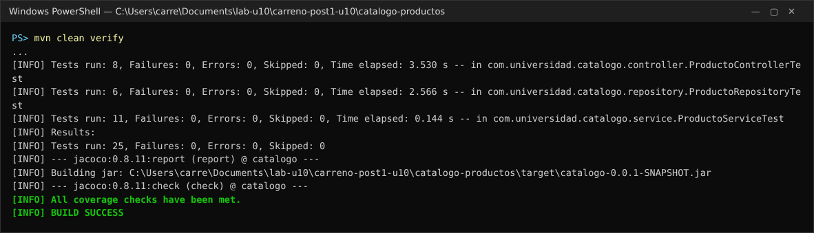
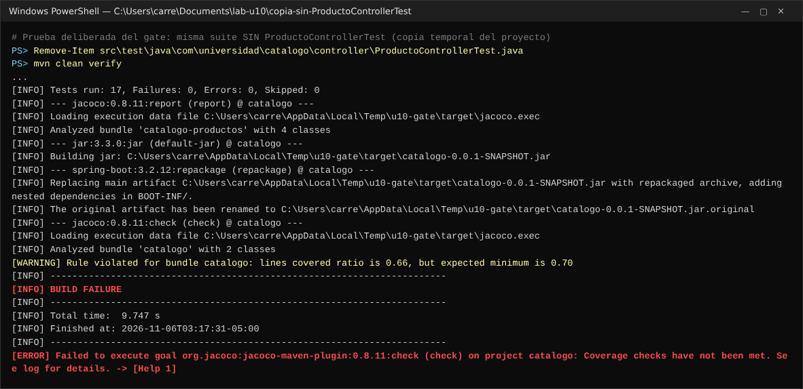
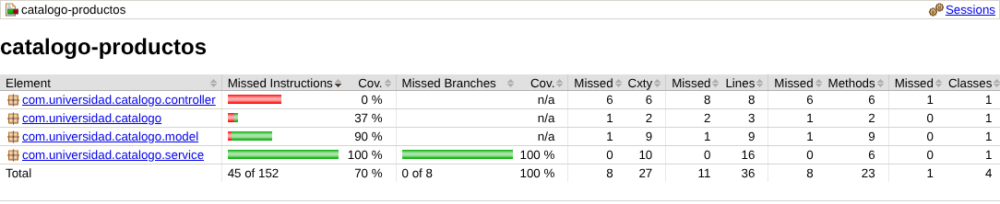

# Post-contenido — Unidad 10: Pruebas de Software en Aplicaciones Web

**Estudiante:** Santiago Carreño Calceto
**Asignatura:** Programación Web — Séptimo Semestre
**Repositorio:** `carreno-post1-u10`

## Descripción

Repositorio del laboratorio de la Unidad 10. Contiene un único proyecto Maven Spring Boot (**`catalogo-productos/`**, paquete raíz `com.universidad.catalogo`) con una suite de pruebas unitarias, de integración y de capa web sobre un catálogo de productos. Además incluye una colección Postman versionada y un umbral de cobertura verificado con JaCoCo.

La aplicación es deliberadamente pequeña: crea productos, los consulta por id, los consulta por categoría y actualiza su precio. El trabajo del laboratorio está en las pruebas.

| Parte | Contenido | Commits |
|-------|-----------|---------|
| **Parte 1** | `Producto`, `ProductoRepository`, `ProductoService` · `ProductoServiceTest` (JUnit 5 + Mockito) · `ProductoRepositoryTest` (`@DataJpaTest` + H2) | 3 (tag `parte-1`) |
| **Parte 2** | `ProductoController` · `ProductoControllerTest` (`@WebMvcTest` + MockMvc) · colección Postman/Newman · JaCoCo con gate del 70 % | 3 + README |

## Tecnologías

- Java 17 (probado con JDK 21) y Spring Boot 3.2.12
- Spring Web, Spring Data JPA (Hibernate 6.4), Bean Validation y H2 en memoria
- JUnit 5, Mockito, AssertJ, MockMvc y `@DataJpaTest` (incluidos en `spring-boot-starter-test`)
- JaCoCo 0.8.11 (`jacoco-maven-plugin`)
- Postman (colección v2.1) y Newman
- Maven Wrapper (`mvnw` / `mvnw.cmd`)

## Estructura

```
carreno-post1-u10/
├── README.md
├── capturas/
├── postman/
│   ├── ColeccionCatalogo.json        colección "API Catálogo de Productos" (4 requests con test scripts)
│   └── env-local.json                entorno "Catalogo-Local" (baseUrl = http://localhost:8080)
└── catalogo-productos/
    ├── pom.xml                       (jacoco-maven-plugin: prepare-agent, report, check >= 70 %)
    └── src/
        ├── main/java/com/universidad/catalogo/
        │   ├── model/Producto.java
        │   ├── repository/ProductoRepository.java
        │   ├── service/ProductoService.java
        │   └── controller/ProductoController.java
        └── test/java/com/universidad/catalogo/
            ├── service/ProductoServiceTest.java          unitarias (Mockito)
            ├── repository/ProductoRepositoryTest.java    integración (@DataJpaTest + H2)
            └── controller/ProductoControllerTest.java    capa web (@WebMvcTest + MockMvc)
```

---

## Parte 1 — Pruebas Unitarias con Mockito y de Integración con @DataJpaTest

### `ProductoServiceTest`: unitarias con Mockito (11 pruebas)

`@ExtendWith(MockitoExtension.class)` con `@Mock ProductoRepository` y `@InjectMocks ProductoService`. No hay base de datos ni contexto de Spring: se prueba **solo la lógica de negocio** (validaciones y manejo del `Optional`). Es la base ancha y rápida de la pirámide: las 11 pruebas corren en milisegundos.

| Prueba | Verifica |
|--------|----------|
| `crear_conDatosValidos_guardaYRetorna` | Caso feliz: guarda y retorna; `verify(repo).save(p)` |
| `crear_conPrecioNegativo_lanzaIllegalArgumentException` | Error 1: precio inválido con `assertThrows`. `verify(repo, never()).save(any())` confirma que la validación rechaza **antes** de tocar el repositorio |
| `crear_conPrecioCero_…`, `crear_conNombreVacio_…`, `crear_conNombreNulo_…` | Bordes de las dos validaciones de `crear` |
| `buscarPorId_existe_retornaProducto` | Optional con valor |
| `buscarPorId_noExiste_lanzaEntityNotFoundException` | Error 2: entidad no encontrada (y su mensaje) |
| `listarPorCategoria_delegaEnElRepositorio_retornaSuResultado` | Delegación al repositorio |
| `actualizarPrecio_conValorValido_actualizaYGuarda` | Caso feliz con `thenAnswer(inv -> inv.getArgument(0))` |
| `actualizarPrecio_conPrecioInvalido_…SinConsultar` | `verifyNoInteractions(repo)`: ni siquiera busca el producto |
| `actualizarPrecio_productoNoExiste_lanzaEntityNotFoundException` | No guarda nada si no existe |

### `ProductoRepositoryTest`: integración con @DataJpaTest (6 pruebas)

`@DataJpaTest` carga **solo** la capa de persistencia: entidades, repositorios y H2 en memoria. `TestEntityManager` inserta los datos de prueba en `setUp()` (Laptop/ELECTRONICA y Cuaderno/PAPELERIA). Cada prueba corre en una transacción que **se revierte** al terminar, así que los dos productos no se acumulan entre pruebas. `count_trasSetUp_retornaSoloLosDosProductosDeLaPrueba` lo comprueba.

Las pruebas cubren `findByCategoria` con una coincidencia, sin coincidencias, con varios productos y con distinción de mayúsculas. También comprueban que `save` asigna el id y que el producto se puede releer desde H2 (con `flush` + `clear` para no leerlo desde la caché del contexto de persistencia).

---

## Parte 2 — Pruebas Web con @WebMvcTest, Postman/Newman y JaCoCo

### `ProductoControllerTest`: capa web con @WebMvcTest (8 pruebas)

`@WebMvcTest(ProductoController.class)` carga solo la capa web: el controlador, Jackson y el manejo de errores de Spring MVC. `ProductoService` se reemplaza con `@MockBean` y `MockMvc` simula las peticiones HTTP sin abrir un puerto.

| Prueba | HTTP |
|--------|------|
| `get_productoExiste_retorna200` | 200 + JSON (`$.nombre`, `$.precio`) |
| `get_noExiste_retorna404` | 404: `EntityNotFoundException` → `@ExceptionHandler` |
| `get_idNoNumerico_retorna400` | 400 sin llamar al servicio |
| `listar_porCategoria_retorna200ConLaLista` | 200 + arreglo de 2 |
| `listar_sinParametroCategoria_retorna400` | 400 (`@RequestParam` obligatorio) |
| `post_conDatosValidos_retorna201` | 201 + `$.id` |
| `post_conPrecioInvalido_retorna400` | 400: `IllegalArgumentException` → `@ExceptionHandler` |
| `post_conJsonMalformado_retorna400` | 400 sin llamar al servicio |

### Colección Postman / Newman

La carpeta `postman/` contiene la colección **"API Catálogo de Productos"** y el entorno **"Catalogo-Local"**. Los 4 requests se ejecutan en orden contra la aplicación real (con su H2 real, sin mocks):

| # | Request | Test scripts |
|---|---------|--------------|
| 1 | `POST /api/productos` (Teclado mecánico, 120.0, ELECTRONICA) | 201 · id numérico (se guarda en `productoId`) · el cuerpo devuelve los datos enviados · tiempo < 500 ms |
| 2 | `GET /api/productos/{{productoId}}` | 200 · Content-Type JSON · el id coincide · el nombre es "Teclado mecánico" |
| 3 | `GET /api/productos?categoria=ELECTRONICA` | 200 · arreglo no vacío · todos son ELECTRONICA · incluye el producto creado |
| 4 | `GET /api/productos/99999` | 404 · el mensaje indica el id no encontrado |

```
newman run postman/ColeccionCatalogo.json --environment postman/env-local.json
```

Resultado: **4 requests, 14 assertions, 0 failures**.



### Cobertura con JaCoCo

El `pom.xml` tiene `jacoco-maven-plugin` 0.8.11 con tres goals:

- `prepare-agent`: agrega el agente de JaCoCo a la JVM de las pruebas.
- `report`: se ejecuta en la fase `test` y genera `target/site/jacoco/index.html`.
- `check`: se ejecuta en la fase `verify` con la regla `BUNDLE` / `LINE` / `COVEREDRATIO` mínimo **0.70**, excluyendo `*Application` y `model/**`.

Con la suite completa, `mvn clean verify` pasa ("All coverage checks have been met"). En el alcance del gate (servicio y controlador), la cobertura de líneas es **100 % (24/24)**. El reporte completo, que incluye también la entidad y la clase `main`, marca **94 % de líneas (34/36)**.






**Prueba deliberada del gate.** Se ejecutó `mvn clean verify` en una copia del proyecto **sin `ProductoControllerTest`**. El controlador quedó en 0 %, la cobertura bajó a **0.66** y el build falló:

```
[WARNING] Rule violated for bundle catalogo: lines covered ratio is 0.66, but expected minimum is 0.70
[INFO] BUILD FAILURE
[ERROR] Failed to execute goal org.jacoco:jacoco-maven-plugin:0.8.11:check (check) on project catalogo: Coverage checks have not been met.
```

Luego se volvió a la versión completa y el build pasó de nuevo.




---

## Orden en que se agregaron los tipos de prueba

1. **Unitarias** (`ProductoServiceTest`): la lógica de negocio es lo que más cambia y lo más barato de probar.
2. **Integración** (`ProductoRepositoryTest`): confirma que la consulta derivada `findByCategoria` funciona contra una base real (H2).
3. **Capa web** (`ProductoControllerTest`): una vez existe el controlador, verifica el contrato HTTP (códigos y JSON) con el servicio simulado.
4. **Extremo a extremo** (colección Postman/Newman): la aplicación completa como caja negra, por HTTP real.
5. **JaCoCo al final**: mide la cobertura agregada cuando las tres capas ya tienen pruebas.

## Decisiones de diseño

1. **H2 también para ejecución local, no solo para pruebas.** El objetivo de la unidad es escribir pruebas, no modelar persistencia contra un motor externo como en la Unidad 8. Instalar MySQL solo agregaría fricción de infraestructura.
2. **`buscarPorId` lanza `EntityNotFoundException` en vez de retornar `null`.** El contrato del método queda explícito, se verifica con `assertThrows` en una línea y ningún llamador tiene que acordarse de revisar `null`. El controlador lo traduce a 404 con `@ExceptionHandler`.
3. **`ProductoRepositoryTest` usa `@DataJpaTest` en vez de `@SpringBootTest`.** Carga solo la capa de persistencia: la prueba queda aislada de fallos ajenos a JPA y la suite sigue rápida a medida que el proyecto crece.
4. **`ProductoControllerTest` usa `@WebMvcTest` en vez de `@SpringBootTest` con `TestRestTemplate`.** Arranca solo la capa web y no ocupa un puerto real. Así no duplica la cobertura de servicio y repositorio, que ya tienen sus propias pruebas.
5. **La colección Postman se versiona como `.json`, no como test JUnit.** Prueba el contrato HTTP completo (serialización, códigos de estado, cabeceras) como caja negra contra un proceso real. Es un nivel distinto y complementario a MockMvc, y la puede ejecutar QA o un consumidor externo fuera de la JVM y de Maven.
6. **JaCoCo se configura al cierre de la Parte 2, no de la Parte 1.** Con solo servicio y repositorio, el umbral mediría una fracción del código y daría una falsa sensación de cumplimiento. Medido al final, refleja el estado real. La prueba del gate lo confirma: sin las pruebas del controlador, la cobertura cae a 66 % y el build falla.
7. **Este laboratorio NO incluye Selenium WebDriver.** El catálogo es una API REST pura (`ProductoController` devuelve JSON, no vistas Thymeleaf). Fabricar una vista HTML solo para automatizarla con Selenium agregaría una capa de presentación ficticia y contradiría la pirámide de pruebas, donde las pruebas E2E se reservan para flujos de usuario reales sobre una interfaz real. En un proyecto con vistas Thymeleaf, como el catálogo con formularios de la Unidad 8, Selenium con Page Object Model sí sería la herramienta correcta. Aquí, la colección Postman cumple el papel de prueba de extremo a extremo sobre la superficie que la aplicación realmente expone: la API HTTP.

Decisión adicional: `pom.xml` agrega `spring-boot-starter-validation`, porque `@NotBlank` en `Producto` necesita la API de Bean Validation para compilar.

## Cómo compilar y ejecutar

1. Clonar el repositorio: `git clone https://github.com/SantiagoCalceto/carreno-post1-u10.git`
2. Ejecutar la aplicación (H2 en memoria, sin instalar nada más):
   ```
   cd catalogo-productos
   ./mvnw spring-boot:run          (Windows: mvnw.cmd spring-boot:run)
   ```
3. Ejecutar la suite completa con verificación de cobertura:
   ```
   ./mvnw clean verify
   ```
   El comando genera el reporte en `target/site/jacoco/index.html` y falla si la cobertura de líneas es menor al 70 %.
4. Con la aplicación en ejecución, correr la colección Postman:
   ```
   npm install -g newman
   newman run postman/ColeccionCatalogo.json --environment postman/env-local.json
   ```
   La misma colección se puede importar en Postman (Import → `postman/ColeccionCatalogo.json` y `postman/env-local.json`) y ejecutar en el Collection Runner con el entorno "Catalogo-Local".

## Capturas de pantalla

| Captura | Muestra |
|---------|---------|
| [jacoco-reporte.png](capturas/jacoco-reporte.png) | Reporte JaCoCo final: servicio y controlador al 100 %, total 94 % de líneas |
| [jacoco-build-fallido.png](capturas/jacoco-build-fallido.png) | `mvn verify` falla por cobertura 0.66 < 0.70 (sin `ProductoControllerTest`) |
| [jacoco-reporte-gate-66.png](capturas/jacoco-reporte-gate-66.png) | Reporte de esa ejecución: controlador en 0 % |
| [tests-verde.png](capturas/tests-verde.png) | 25 pruebas en verde (11 unitarias, 6 de integración, 8 web) y BUILD SUCCESS |
| [newman-0-failures.png](capturas/newman-0-failures.png) | Colección ejecutada con Newman: 4 requests, 14 assertions, 0 failures |
| [jacoco-productoservice.png](capturas/jacoco-productoservice.png) / [jacoco-productocontroller.png](capturas/jacoco-productocontroller.png) | Líneas cubiertas (verde) por clase |
